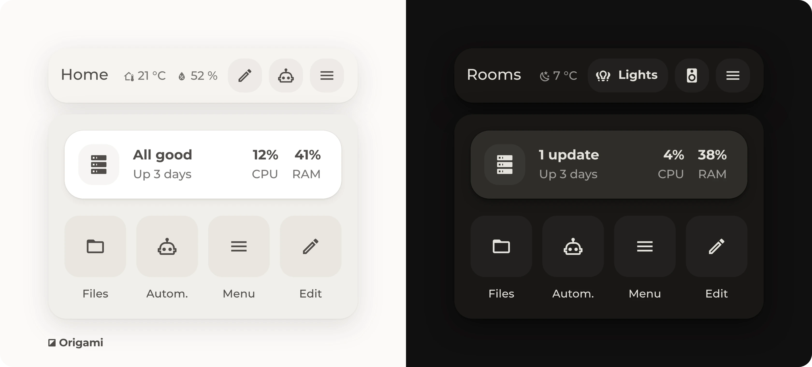
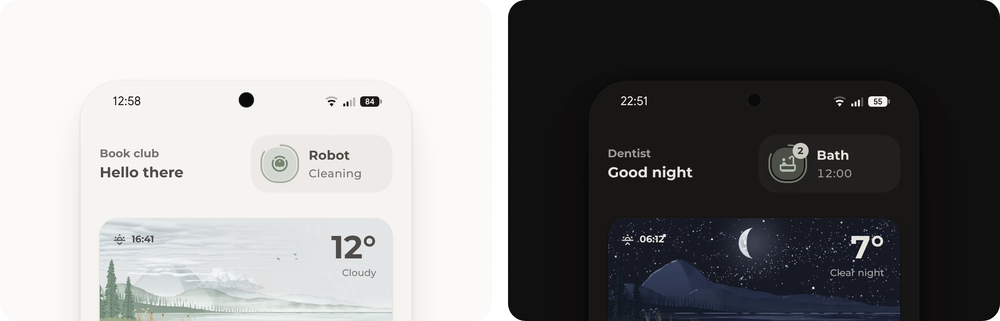
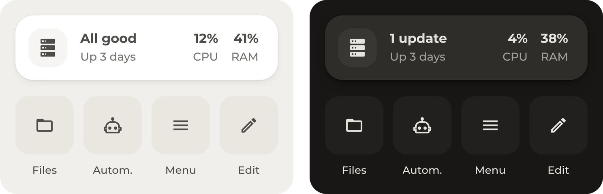

# ◪ Origami Header

<div>
<a href="https://github.com/hazymorning/origami_header/releases/latest"></a>
<a href="https://github.com/hazymorning?tab=repositories&q=origami"></a>
</div>

<br>



Origami Header hides the dashboard header in Home Assistant without the flash. Kiosk mode and CSS still show the header for a moment every time a dashboard opens. With Origami Header, it never appears.

> [!NOTE]
> Home Assistant has no proper way to hide the header, so Origami Header is a bit hacky and experimental.

[Get started](#get-started) · [Modes](#modes) · [More](#more)

## Get started

<details>
<summary><b>Install the module</b></summary>

<br>

Origami Header needs Home Assistant 2026.9 or newer.

1. Open Origami Header in HACS. If HACS asks to add the repository, select **Add**. Then select **Download**.

   [](https://my.home-assistant.io/redirect/hacs_repository/?owner=hazymorning&repository=origami_header&category=plugin)

2. Add it to [`configuration.yaml`](https://www.home-assistant.io/docs/configuration/#editing-configurationyaml) as an extra module. If `frontend:` is already there, only the `extra_module_url` lines go under it.

   ```yaml
   frontend:
     extra_module_url:
       - /hacsfiles/origami_header/origami-header.js
   ```

3. Restart Home Assistant.

It has to be an extra module, because a dashboard resource loads too late, when the default header is already on screen.

Without HACS, copy `origami-header.js` from the [latest release](https://github.com/hazymorning/origami_header/releases/latest) to `/config/www` and use `/local/origami-header.js?v=0.4.3` as the extra module. The version at the end changes with each update, so the browser loads the new file.

</details>

<details>
<summary><b>Add the card</b></summary>

<br>

1. Edit a dashboard and add the **Origami Header** card to any view.
2. Choose **No header**, or one of the modes that put something in its place.

The card changes the header of the whole dashboard and stays invisible itself.

- Only admins see the change, unless `all_users` is on.
- In edit mode, the default header comes back. Edit mode opens from a button with `special: edit`, a card with the `origami_header: edit` action, or with `?edit=1` at the end of the address.

</details>

## Modes

<sub>The images show the [Origami](https://github.com/hazymorning/origami) theme.</sub>

### No header



The header is gone, and the dashboard starts right at the top. This is what Origami Header was made for.

### Custom header


Cards and buttons in the header's place. When the buttons don't fit, they move to a second row.

<details>
<summary><b>The header in the image</b></summary>

<br>

Buttons work like the button badges of a heading card and can have an icon, a name or both. `cards` takes any card, such as a clock. The `css` uses variables of the [Origami theme](https://github.com/hazymorning/origami).

```yaml
type: custom:origami-header-card
mode: header
cards:
  - type: heading
    heading: Home
    badges:
      - type: entity
        entity: sensor.living_room_temperature
        icon: mdi:home-thermometer-outline
      - type: entity
        entity: sensor.living_room_humidity
        icon: mdi:water-percent
buttons:
  - icon: mdi:pencil-outline
    special: edit
  - icon: mdi:robot-outline
    tap_action:
      action: navigate
      navigation_path: /config/automation/dashboard
  - icon: mdi:menu
    special: sidebar
css: |
  :host([mode="header"]) .bar {
    padding: var(--ha-space-3) var(--view-bleed) var(--ha-space-4);
    border-bottom: none;
  }
  :host([mode="header"]) .cards {
    flex: 1 1 auto;
    margin-inline-start: calc(-1 * var(--ha-space-1));
  }
  :host([mode="header"]) .buttons {
    gap: var(--ha-space-2);
  }
  :host([mode="header"]) .button {
    height: var(--control-height-icon);
    min-width: var(--control-height-icon);
    border-radius: var(--radius-inner);
    background: var(--fill-subtle);
    box-shadow: none;
  }
  :host([mode="header"]) .button ha-icon {
    color: var(--color, var(--primary-text-color));
    --mdc-icon-size: var(--icon-size-s);
  }
  :host([mode="header"]) .name {
    font-weight: var(--ha-font-weight-bold);
  }
```

</details>

### Fold-out menu



No header, and a menu that folds out at a tap on another card. The image shows the [menu of the Origami dashboard](https://github.com/hazymorning/origami/tree/main/dashboard/menu).

<details>
<summary><b>Open the menu</b></summary>

<br>

With `mode: menu`, another card opens the menu with this action:

```yaml
tap_action:
  action: fire-dom-event
  origami_header: toggle
```

Besides `toggle`, the action takes `open`, `close`, `edit` and `sidebar`. The menu closes at a tap outside or on one of its buttons, with Escape, or when it's swiped back.

</details>

## More

<details>
<summary><b>Options</b></summary>

<br>

The visual editor covers every option, and in edit mode the card shows a preview.

| Option | Default | Description |
| --- | --- | --- |
| `mode` | `header` | `header`, `menu` or `hidden` |
| `buttons` | Edit, Automations, Tools and Sidebar | The buttons, or `[]` for none |
| `cards` | | One card or a list of cards |
| `position` | `top` | The edge the menu opens from, `top` or `bottom` |
| `layout` | `list` | The buttons in the menu, `list` with two columns or `grid` with four |
| `all_users` | `false` | Shows it to everyone. Otherwise other users get no header at all. |
| `css` | | Custom styles, see Styling below |

Each button takes `name`, `icon`, `color` (a theme color like `amber` or any CSS color) and `tap_action`, `hold_action` and `double_tap_action`. Instead of a tap action, `special: edit` turns on edit mode and `special: sidebar` opens or closes the sidebar. Only admins see the edit button.

Only the first Origami Header card of a dashboard counts, and visibility conditions on it are ignored.

</details>

<details>
<summary><b>Styling</b></summary>

<br>

The buttons follow the theme and use the same variables as cards and badges. For anything else, the `css` option targets these classes:

| Class | Part |
| --- | --- |
| `.bar` | The custom header |
| `.scrim`, `.sheet` | The backdrop and the menu |
| `.cards`, `.buttons` | The cards and the buttons |
| `.button`, `.button ha-icon`, `.button ha-ripple`, `.name` | A button, its icon, its ripple and its name |
| `.note` | The "No header" text in the card preview |

`:host([open])` matches while the menu is open. This blurs the dashboard behind the menu:

```yaml
css: |
  .scrim {
    -webkit-backdrop-filter: blur(12px);
    backdrop-filter: blur(12px);
  }
```

</details>

<details>
<summary><b>How it works</b></summary>

<br>

Home Assistant has a placeholder for the header, and the default header only shows up when nothing else fills it. Origami Header fills it, or hides the header, after the dashboard is built but before the browser shows it, so the default header never appears. If an update changes that placeholder, Origami Header keeps the default header and logs a warning, so the dashboard stays usable.

</details>

<sub>Origami Header exists out of pure frustration. For years, a flickering header was annoying every single day, and no forum had a fix. Research with the help of AI led to a prototype that isn't the cleanest solution, but by far the most effective one. Its main purpose is to hide that header, and everything else is a bonus.</sub>
